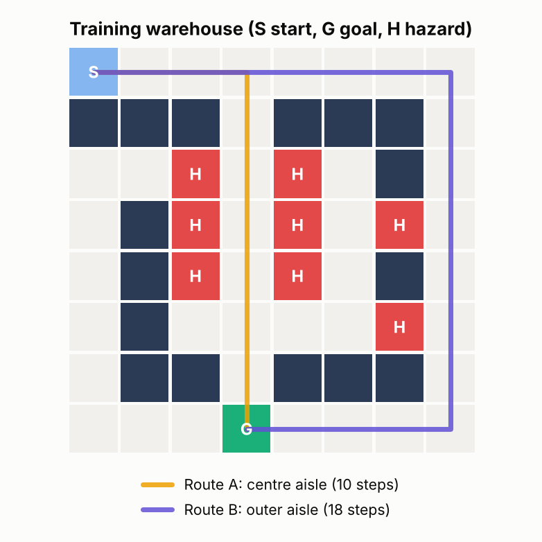
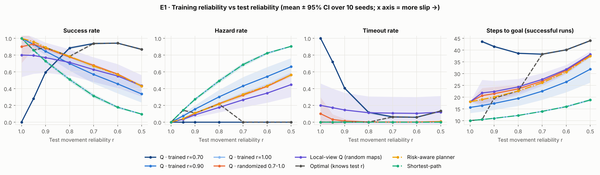
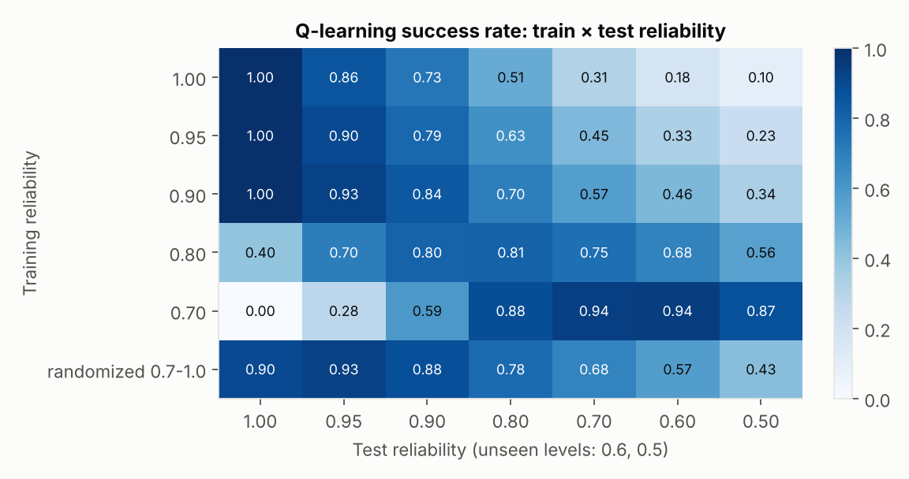
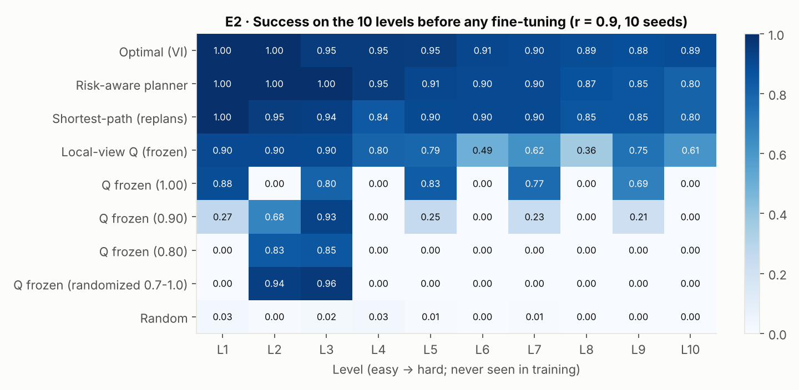
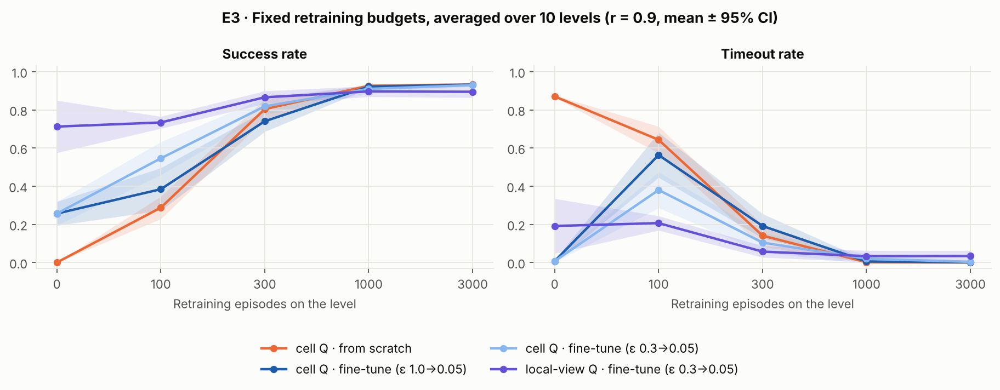
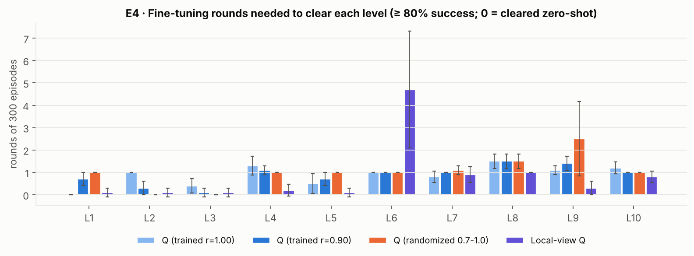

# SafeRoute — Does training under uncertain movement make a navigation agent safer?

*Technical report · tabular reinforcement learning · 8 × 8 warehouse grid*

## 1. Research question

A delivery robot must cross a warehouse floor from a loading dock to a delivery point while avoiding shelves (impassable) and hazards (spill / forklift zones that end the episode). Real robots do not always move where they intend. We ask:

> **RQ1.** Is a Q-learning agent trained with *uncertain* movement safer and more reliable at test time — including under movement-error levels it never saw — than one trained with *perfect* movement?
>
> **RQ2.** Does that agent generalise to 10 unseen, increasingly difficult floor layouts ("levels"), and can a small amount of fine-tuning recover performance?

## 2. Environment

| Item | Setting |
|---|---|
| Grid | 8 × 8, fixed training map (Fig. 1); start top-left, goal bottom row |
| Movement | reliability *r*: intended move with prob. *r*, otherwise a 90° slip left or right (each (1−*r*)/2). Bumping a shelf/wall = stay in place |
| Rewards | −0.2 per step, +10 goal, −10 hazard (terminal); timeout after 60 steps |
| Discount | γ = 0.98 |

The map is built around a deliberate trade-off (Fig. 1):

* **Route A — centre aisle:** 10 steps, but three cells have a hazard on *both* sides.
* **Route B — outer aisle:** 18 steps, with a hazard on *one* side for two cells.



## 3. Agents

| Agent | Description |
|---|---|
| **Q-learning** | Tabular, one-step Q-learning; ε-greedy 1.0 → 0.05 over 70% of training, learning rate 0.2 → 0.02; 3,000 episodes. Trained at *r* ∈ {1.0, 0.95, 0.9, 0.8, 0.7} and with **randomised** *r* ~ U(0.7, 1.0) per episode |
| **Local-view Q** | Tabular Q-learning whose state is what the robot *sees*, not its cell: for each of the 4 neighbours one of {wall, hazard, goal, free, free + planner's suggested step} (625 states). Trained for 20,000 episodes on 300 random floors (none of them a level) with *r* ~ U(0.7, 1.0) |
| Shortest-path | Closed-loop BFS planner that knows the true map, treats hazards as walls and replans from wherever it is. Not risk-aware |
| Risk-aware planner | Dijkstra on the true map where entering a cell costs 1 + 8 × (adjacent hazards, max 2). Gives the local-view agent its hint; does not know *r* and does not learn |
| Random | Uniform random actions |
| Optimal *(reference)* | Value iteration with the true map **and** true test *r*: the best achievable expected return. Used to check Q-learning, not as a competitor |

## 4. Protocol

* **Seeds:** 10 training seeds per configuration. **Train/test separation:** training uses seed *s*; evaluation uses an independent random stream (100000 + *s*); policies are frozen (greedy) during testing.
* **E1 — Reliability study:** fixed map; each trained agent is tested at *r* ∈ {1.0, 0.95, 0.9, 0.8, 0.7, 0.6, 0.5}, 300 episodes per (agent, seed, *r*). 0.6 and 0.5 are harder than anything seen in training.
* **Levels:** 10 test-only floors, same start/goal, hazards moved and shelves shifted, with the budget rising from 3 hazards / 1 shifted shelf (Level 1) to 12 hazards / 5 shelves (Level 10). Each level was picked from 30 candidates so that difficulty rises and the optimal policy still delivers ≥ 85% of the time at *r* = 0.9 (100% on Level 1 → 88.5% on Level 10), so an 80% bar is reachable everywhere.
* **E2 — Generalization:** frozen agents on all 10 levels at *r* ∈ {1.0, 0.9, 0.8}.
* **E3 — Fixed retraining budgets:** on each level, 0 / 100 / 300 / 1,000 / 3,000 episodes of (a) fine-tuning the *r* = 0.9 cell Q-table with ε restarting at 1.0, (b) the same with ε starting at 0.3, (c) cell Q from scratch, (d) fine-tuning the local-view agent (ε from 0.3); tested at *r* = 0.9, 200 episodes.
* **E4 — Level campaign:** the dashboard's procedure. Evaluate the agent on the level (200 episodes, *r* = 0.9); while success < 80%, fine-tune one round of 300 episodes (ε 0.3 → 0.05) and re-evaluate; give up after 15 rounds.
* **Metrics:** success rate, hazard rate, timeout rate, steps-to-goal (successful episodes only), mean return. Reported as mean over seeds ± 95% CI (1.96 · SD/√n).

Everything is regenerated by `python experiments/run_experiments.py` (≈1.5 minutes on a laptop); a second run produces byte-identical CSVs.

## 5. Results

### 5.1 E1 — Training reliability vs test reliability




**Selected cells (mean over 10 seeds):**

| Agent (train *r*) | Test *r* = 1.0 success | Test 0.9 success / hazard | Test 0.8 success / hazard | Test 0.6 (unseen) success / hazard |
|---|---|---|---|---|
| Q, perfect (1.0) | **100%** | 73% / 27% | 51% / 49% | 18% / 82% |
| Q, 0.9 | **100%** | 85% / 16% | 70% / 30% | 46% / 54% |
| Q, 0.8 | 40% (60% timeout) | 80% / 7% | 81% / 15% | 68% / 30% |
| Q, 0.7 | **0%** (100% timeout) | 60% / 0% | **88% / 0%** | **94% / 0%** |
| Q, randomised 0.7–1.0 | 90% | **88%** / 11% | 78% / 22% | 57% / 43% |
| Shortest-path | 100% | 73% / 27% | 51% / 49% | 18% / 82% |
| Optimal (knows test *r*) | 100% | 89% / 11% | 78% / 22% | 94% / 0% |
| Random | 0% | 0% / 46% | 0% / 47% | 0% / 46% |

At test *r* = 0.8 the perfect-movement agent succeeds 50.9% ± 2.3% of the time; the *r* = 0.9 agent 69.9% ± 8.3%, and the randomised agent 77.7% ± 1.1%.

**Findings**

1. **Yes — training with slip produces safer behaviour under slip.** The perfect-movement agent learns Route A (10 steps, identical to the shortest-path planner) and its hazard rate climbs from 0% to 82% as test reliability falls to 0.6. Agents trained with slip move to Route B and cut hazard rates substantially at every noisy test level (at test *r* = 0.8: 49% → 30% / 15% / 0% for training *r* = 0.9 / 0.8 / 0.7), paying with longer routes (≈ 17–40 vs 11–16 steps).
2. **But "more noise in training" is not monotonically better — agents over-fit the noise model.** At *r* = 0.7 the optimal behaviour (confirmed by value iteration) is a *wall-crawl*: next to a one-sided hazard the robot deliberately pushes into the outer wall and lets slips carry it along, so it can never fall into the hazard. It never touches a hazard at any test level — yet with perfect movement the trick stalls completely (**0% success, 100% timeouts**). The *r* = 0.8 agent learns it in 6 of 10 seeds.
3. **Randomised training is the most robust single policy.** Trained on *r* ~ U(0.7, 1.0), it matches or beats every fixed-*r* agent at test *r* = 0.9–0.95, is behind only the noise specialists at 0.8, keeps 90% success at *r* = 1.0, and degrades gracefully on the unseen 0.6/0.5 levels. It is the best answer to "we don't know the deployment noise level".
4. **Near the route-switching threshold, seeds disagree.** At train *r* = 0.9, 7/10 seeds choose Route B and 3/10 Route A; at 0.95 it is 4/10 vs 6/10. Value iteration places the switch between 0.95 and 0.9, so the two routes are nearly tied there — a reason to always report multiple seeds.
5. **Q-learning matches the optimum when train = test.** Matched-condition Q-agents are within a few points of the value-iteration reference (e.g. 85% vs 89% at 0.9, 88% vs 94% at 0.7 & 0.6). Note that the optimum maximises *return*, not success: at *r* = 0.95 it accepts a 14% hazard risk to save 8 steps.

### 5.2 E2 — Ten unseen levels, before any fine-tuning



| Agent (frozen) | Mean success, *r* = 0.9 | Levels ≥ 80% |
|---|---|---|
| Optimal (knows map + *r*) | 93% | 10 / 10 |
| Risk-aware planner | 92% | 10 / 10 |
| Shortest-path (replans) | 89% | 10 / 10 |
| **Local-view Q** | **71%** | 3 / 10 (L4, L5, L9 at 75–80%) |
| Cell Q, trained *r* = 1.0 | 40% | 3 / 10 |
| Cell Q, trained *r* = 0.9 | 26% | 1 / 10 |
| Cell Q, randomised *r* | 19% | 2 / 10 |

* **Cell-index Q-tables memorise the floor.** They only succeed where the new floor happens to keep the old route open (the perfect-movement table works on Levels 1, 3, 5, 7, 9, where the centre aisle is still clear, and scores 0% on the others). The state is just the cell number, so the agent replays its memorised route into hazards that have moved or pushes against a new shelf until it times out. Slip-trained tables transfer *worse*: their outer-aisle route survives intact only in Levels 2 and 3, which are exactly the levels where they succeed.
* **Seeing the neighbourhood transfers.** The local-view agent, which never saw a level, averages 71% (90% on Levels 1–3, 36–62% on the hardest). That is a large gain over cell-index Q, but it is **below the risk-aware planner that supplies its hint (92%)**. Learning over a coarse 625-state observation sometimes overrides a good suggestion in states that look alike but are not (state aliasing). On this problem, a map-reading risk-aware planner is a very strong baseline.

### 5.3 E3 — Fixed retraining budgets



| Success after N episodes on the level (mean of 10 levels × 10 seeds) | 0 | 100 | 300 | 1,000 | 3,000 |
|---|---|---|---|---|---|
| Cell Q · fine-tune, ε restarts at 1.0 | 26% | 38% | 74% | 92% | 93% |
| Cell Q · fine-tune, ε starts at 0.3 | 26% | **55%** | **82%** | 91% | 93% |
| Cell Q · from scratch | 0% | 29% | 80% | 93% | 93% |
| Local-view Q · fine-tune, ε 0.3 | **71%** | **73%** | **87%** | 90% | 89% |

* **Fine-tuning helps when it does not throw the old table away.** With ε restarting at 1.0 the agent re-explores almost from scratch; starting at ε = 0.3 reuses what it knew and gives the best cell-Q results at 100–300 episodes. (In an earlier 5-layout pilot with only the ε = 1.0 schedule, fine-tuning even looked *slower* than scratch; this was the exploration schedule, not the prior knowledge.)
* **Local-view Q starts far ahead** and is best up to 300 episodes, but plateaus near 90%. With 625 aliased states it cannot represent level-specific detours as precisely as a 64-cell table, which overtakes it at 1,000+ episodes.

### 5.4 E4 — Level campaign (what the dashboard does live)



| Starting agent | Levels cleared (10 levels × 10 seeds) | Cleared with 0 rounds | Mean fine-tune episodes | Worst case |
|---|---|---|---|---|
| Cell Q, trained *r* = 1.0 | 100% | 24% | 264 | 3 rounds |
| Cell Q, trained *r* = 0.9 | 100% | 22% | 264 | 2 rounds |
| Cell Q, randomised *r* | 100% | 20% | 303 | 10 rounds |
| Local-view Q | 100% | **56%** | **249** | 12 rounds |

Every agent cleared every level on every seed, usually within **one round of 300 episodes**. The local-view agent clears more than half of all (seed, level) pairs with no training at all, but has a long tail: on Level 6 one seed needed 12 rounds. For a level campaign, "a slightly-better-than-random start + short low-ε fine-tuning" is enough on 8 × 8 floors; the real value of the local-view agent is that it often needs none.

## 6. Conclusions

* **RQ1:** Training under uncertain movement makes Q-learning markedly safer when the deployment robot also slips, including at error levels never seen in training. The benefit is conditional: over-estimating noise yields over-cautious, noise-exploiting policies that fail when movement is reliable. Training across a *range* of reliabilities is the most dependable recipe.
* **RQ2:** Safety learned by a cell-index Q-table does not transfer to a rearranged floor. Giving the agent a local view of its neighbours (plus a planner hint) and training it on many random floors raises zero-shot success on 10 unseen levels from 19–40% to 71%, though a map-reading risk-aware planner remains stronger (92%). Short fine-tuning recovers every level: one 300-episode round is usually enough if fine-tuning starts from low exploration.

## 7. Limitations

* **Tiny, hand-designed world.** One 8 × 8 map whose trade-off was built on purpose; effects sizes depend on that design and the reward scale (−10 hazard vs −0.2 per step).
* **Tabular state.** Cell-index Q cannot transfer by construction. The local-view agent fixes this coarsely (625 states, aliasing, plateau near 90%) and relies on a privileged planner hint from the true map; a function-approximation agent (e.g. DQN on a local image patch, without the hint) is the natural next step.
* **Levels share one warehouse.** Start and goal never move and the levels are generated from the training floor; "unseen" means unseen hazard and shelf positions, not a new building.
* **Simple noise model.** Slips are independent, symmetric and 90°; real errors are correlated, drift-like or speed-dependent.
* **Return ≠ safety.** The agent maximises discounted return; we did not use a constrained or risk-sensitive objective (CVaR, safety penalty schedules), which would let safety be targeted directly.
* **Baselines.** The shortest-path planner is deliberately risk-naïve and has privileged map knowledge; a risk-aware planner is equivalent to the value-iteration reference.
* **Campaign bar.** "Cleared" means ≥ 80% of 200 episodes at *r* = 0.9 with the same test stream across rounds, so a borderline policy can pass partly by luck of that stream; the dashboard and E4 use the same rule.
* **Statistics.** 10 seeds × 300 test episodes; CIs are across seeds and assume approximate normality.

## 8. Reproducing

```bash
pip install -r requirements.txt
python experiments/run_experiments.py     # ~1.5 min, writes results/
python experiments/make_figures.py        # writes report/figures/
python tests/test_core.py                 # or: pytest -q
python tests/smoke_app.py                 # headless dashboard + full campaign
streamlit run app/streamlit_app.py        # dashboard + arcade
```
All settings live in `config.json`; `results/config_used.json` records the exact configuration of the last run.
